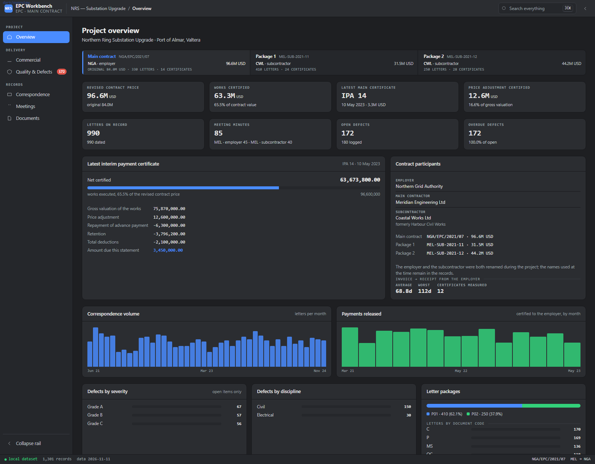
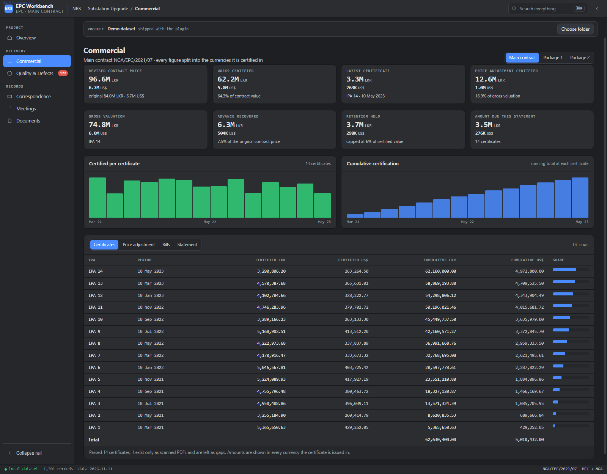

# EPC Project Workbench

A project-controls workbench for an EPC contract, delivered as a plugin for
[DeepSeek Harness](https://github.com/deepseek-ai). It reads the project records a
contractor already keeps — correspondence, minutes, the payment register, defect logs,
certificate workbooks, document folders — and renders them as one page: how much has
been certified, what is still unpaid, what was written, what is open, what was handed
over.

It is read from the **main contractor's** side of the contract: the contractor is paid
by the employer under the main contract, and pays its subcontractor under each package.
Every view can be switched to any of those contracts, and the numbers, charts, tables
and the statusbar follow the selection.



The visual language follows [massing.build](https://massing.build/app/): one meaning per
colour, a left icon rail grouped into clusters, a compact topbar and statusbar, and
monospaced data columns. Dark and light themes, English and Chinese copy.

## What it shows

| View | Contents |
| --- | --- |
| **Overview** | Contract register strip; the money band for the selected contract (revised price with the original beside it, works certified against that cap, latest certificate, price adjustment); project KPIs; the latest certificate card with its closing statement; the contract participants; correspondence volume and payment-release charts; defect severity, discipline and package breakdowns |
| **Commercial** | Main-contract certificate register with the second-currency split and a share column; the escalation ledger; the bill-level summary of the latest certificate; the closing statement. Per-package: payment certificates, receipts from the employer, retention and advance recovery, and the certificate's bill-of-quantities detail |
| **Correspondence** | Every letter, filtered by contract, with document-code distribution, volume by month and most frequent subjects recomputed from the selected contract |
| **Meetings** | Minute books grouped by series, volume chart, filterable register |
| **Quality & Defects** | Defect register with status, overdue count, severity and priority mix, top locations, and a filterable table showing days remaining |
| **Documents** | Contract and insurance documents, taking-over certificates (issued vs draft), signed certificate scans indexed by reference, material submission packages, media counts, retention and advance balances |

Global search (`⌘K` / `Ctrl-K`) runs over the flat record index — one row per letter,
minute, defect, certificate and scanned certificate — and jumps to the owning view.



## Demo data

`data/` contains a **synthetic project** (`Northern Ring Substation Upgrade`) with 990
letters, 85 sets of minutes, 180 defects, 24 subcontract certificates and 14
main-contract certificates. It exists so the plugin renders something meaningful on
first install; no real project data is included, and `tools/make_demo.py` regenerates it
deterministically.

Point it at a real corpus by writing a configuration file — see
[docs/CONFIGURATION.md](docs/CONFIGURATION.md):

```bash
cp workbench.config.example.json workbench.config.json
# edit: parties, contracts, sources.root, folder names, sheet names
python tools/build_data.py
```

The extractor is tolerant by design: every source is optional, and a folder that is not
there produces an empty section rather than a failed build, so a workbench can start
with correspondence and grow into payments later.

## Installing as a Harness plugin

The package root is the plugin: `index.js` is the host half (it registers two read-only
JSON routes), `client.js` is the built client half, `cordis.patch.yml` mounts it into the
Web UI.

From npm:

```bash
dsh plugin add dsh-epc-workbench       # or: plugin_manager install_bundle
```

From a checkout:

```bash
git clone https://github.com/lujia/dsh-epc-workbench
dsh plugin add ./dsh-epc-workbench     # or: plugin_manager install_bundle
```

The workbench then appears as a page in the Harness Web UI and renders the demo dataset
until `data/` is rebuilt from a real corpus.

The npm package carries the runtime surface plus what is needed to point it at your own
records: `index.js`, `client.js`, `icon.svg`, `cordis.patch.yml`, the two locales, the
demo dataset, `workbench.config.example.json`, `docs/CONFIGURATION.md` and the three
extractor scripts (`tools/build_data.py`, `tools/epc_config.py`, `tools/make_demo.py`).
`src/`, `preview/` and the client build/smoke i18n scripts are development aids that only
the git checkout has.

## Rebuilding

```bash
python tools/build_data.py        # corpus  -> data/workbench.json + data/index.json
node   tools/build_client.mjs     # src/client/*.js -> client.js
node   --check client.js
node   tools/smoke.mjs            # headless render of every view and forced state
node   tools/check_i18n.mjs       # EN/ZH key coverage
node   tools/preview.mjs overview # static HTML for screenshot review (dev only)
```

`src/client/*.js` are concatenated in filename order into one module, so a helper
defined in `src/client/35_scope.js` is visible to every later fragment. That is why the
fragments are numbered and why functions are declared rather than imported.

The host half caches the parsed dataset by file size and modification time, so a rebuild
of the data is picked up on the next request. Changes to `index.js` itself need the
bundle toggled off and on again in the plugin manager.

## How the data is shaped

`tools/build_data.py` writes two files:

- `data/workbench.json` — the aggregated dataset: project identity, taxonomy, contracts,
  letters, meetings, defects, payments, retention, the latest certificate, the
  main-contract certificate series and the document counts.
- `data/index.json` — a flat array of `[kind, reference, date, text, tag, file]` rows for
  search, where `kind` is `L` letter, `M` minutes, `D` defect, `I` subcontract
  certificate, `C` main-contract certificate or `S` scanned certificate.

The client never hardcodes a project's vocabulary. Series keys, contract ids, party names
and contract numbers all arrive inside the payload (`taxonomy`), which is why the same
bundle serves any project: `contractLabel(data, id)` and `seriesLabel(data, key)` look
those names up rather than printing a literal.

### Money is a list of currency slices

An EPC contract is often priced in more than one currency — imported plant in dollars,
site works in the local currency — and the bill rows carry one amount per currency. The
two are additive, not conversions of each other, so a figure printed in one currency
understates the contract by the other. The payload therefore declares the currencies it
uses and writes the slices out explicitly:

```json
"currencies": [
  {"code": "LKR", "label": "LKR", "key": "Lkr", "primary": true},
  {"code": "USD", "label": "US$", "key": "Usd", "primary": false}
],
"mainContract": {"contract": {"amounts": [{"code": "LKR", "amount": 96600000.0},
                                          {"code": "USD", "amount": 6720000.0}],
                              "amountsOrig": [ ... ]}},
"contracts": [{"id": "MAIN", "amounts": [ ... ], "amountsOrig": [ ... ]}]
```

Every scalar money field is written once per currency with the currency's `key` as the
suffix — `grossCumLkr` / `grossCumUsd`, `curLkr` / `curUsd`, `contractLkr` / `contractUsd`.
`rowSlices(row, 'grossCum', data)` reads them back as a list in the declared order, and the
client prints every slice it finds: a money tile keeps the first currency large and stacks
the rest beneath it, and the certificate, bills and statement tables build one column per
currency. Adding a third currency means adding an entry to `currencies` and another set of
suffixed fields — no template change, and no figure silently dropped.

## Layout

```
index.js                  host half — two read-only JSON routes, mtime-keyed cache
client.js                 client half — built artifact
src/client/*.js           client sources, concatenated in filename order
  00_head.js              module wrapper
  10_css.js               the whole stylesheet
  20_lib.js               formatting, charts, small primitives
  30_i18n.js              EN and ZH copy
  35_scope.js             contract register, scope resolution, shared money helpers
  40_overview.js          50_commercial.js  60_correspondence.js
  70_quality.js           80_shell.js
data/workbench.json       aggregated dataset
data/index.json           flat search index
tools/build_data.py       corpus -> data files, config-driven
tools/epc_config.py       configuration loading and validation
tools/make_demo.py        synthetic dataset generator
tools/build_client.mjs    concatenation + wrap
tools/smoke.mjs           headless render test
tools/check_i18n.mjs      locale coverage audit
tools/preview.mjs         static preview pages
docs/CONFIGURATION.md     every configuration key
```

## Privacy

The plugin ships no project data: the committed dataset is generated by
`tools/make_demo.py` and every name in it is invented. A dataset built from a real
corpus contains contract sums, party names and correspondence subjects — keep
`workbench.config.json` and any real `data/` out of version control. `.gitignore`
already excludes the former, and `preview/` output.

## Publishing a release

The package name is `dsh-epc-workbench` and it is unscoped, so `publishConfig.access`
is `public`. Publishing needs an npm account with publish rights on that name:

```bash
pnpm login                 # or: npm login
pnpm pack --pack-destination .     # inspect what would be uploaded
pnpm publish --no-git-checks       # --tag next for a pre-release
```

`pnpm pack` is the check that matters: it prints the exact file list, and the list must
never contain `workbench.config.json`, `src/`, `preview/` or `.git`. Bump `version`
before each publish — npm refuses to overwrite a version that already exists.

Anyone can then install it into their own Harness profile:

```bash
dsh plugin add dsh-epc-workbench
```

## Licence

MIT — see [LICENSE](LICENSE).
