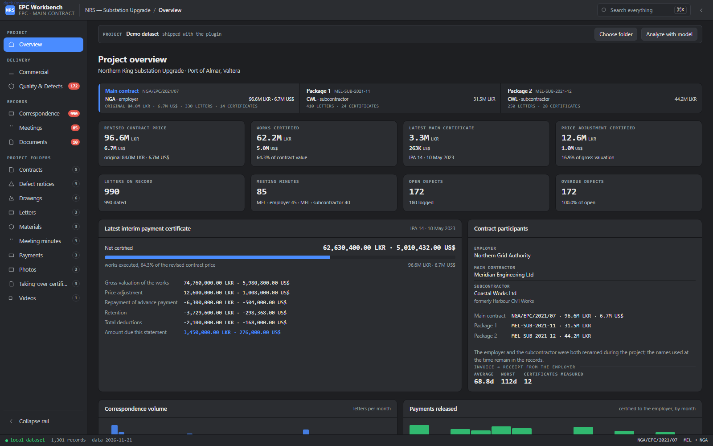
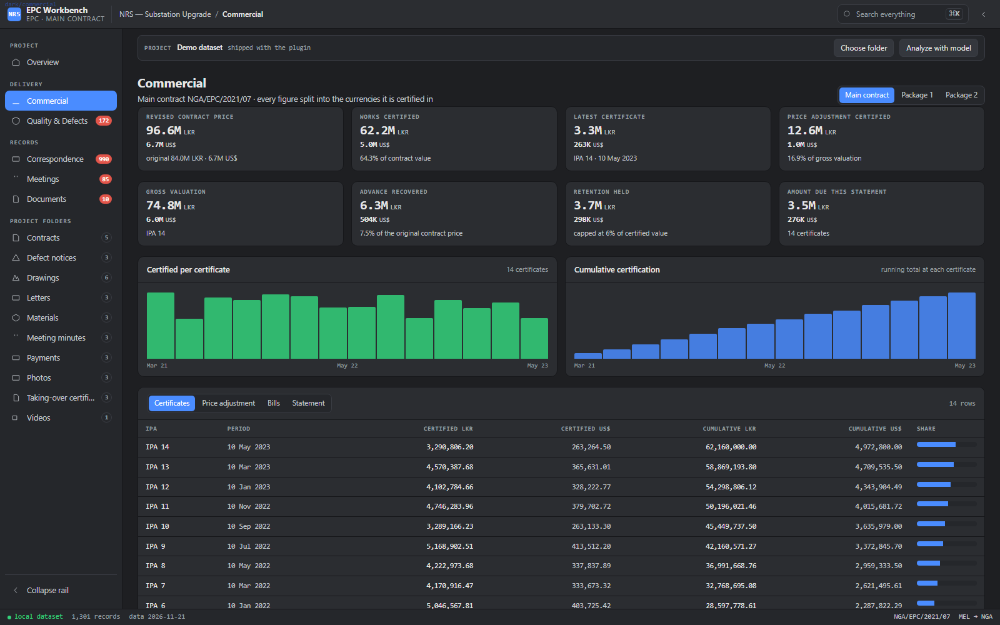

# EPC Project Workbench

A project-controls workbench for an EPC contract, delivered as a plugin for
[DeepSeek Harness](https://github.com/deepseek-ai). It reads the project records a
contractor already keeps — correspondence, minutes, the payment register, defect logs,
certificate workbooks, document folders — and renders them as one page: how much has
been certified, what is still unpaid, what was written, what is open, what was handed
over.

It is read from the **main contractor's** side of the contract: the contractor is paid
by the employer under the main contract, and pays its subcontractor under each package.
Every view can be switched to any of those contracts, and the numbers, charts, tables
and the statusbar follow the selection.



The visual language follows [massing.build](https://massing.build/app/): one meaning per
colour, a left icon rail grouped into clusters, a compact topbar and statusbar, and
monospaced data columns. Dark and light themes, English and Chinese copy.

## What it shows

| View | Contents |
| --- | --- |
| **Overview** | Contract register strip; the money band for the selected contract (revised price with the original beside it, works certified against that cap, latest certificate, price adjustment); project KPIs; the latest certificate card with its closing statement; the contract participants; correspondence volume and payment-release charts; defect severity, discipline and package breakdowns |
| **Commercial** | Main-contract certificate register with the second-currency split and a share column; the escalation ledger; the bill-level summary of the latest certificate; the closing statement. Per-package: payment certificates, receipts from the employer, retention and advance recovery, and the certificate's bill-of-quantities detail |
| **Correspondence** | Every letter, filtered by contract, with document-code distribution, volume by month and most frequent subjects recomputed from the selected contract |
| **Meetings** | Minute books grouped by series, volume chart, filterable register |
| **Quality & Defects** | Defect register with status, overdue count, severity and priority mix, top locations, and a filterable table showing days remaining |
| **Documents** | Contract and insurance documents, taking-over certificates (issued vs draft), signed certificate scans indexed by reference, material submission packages, media counts, retention and advance balances |
| **Project folders** | One page per subject folder — contracts, defects, drawings, letters, materials, meetings, payments, photos, taking-overs and videos. Each page lists what the folder holds, grouped by subfolder, with size and format; format and subfolder bars; a rail badge carrying the folder's own file count |

Global search (`⌘K` / `Ctrl-K`) runs over the flat record index — one row per letter,
minute, defect, certificate and scanned certificate — and jumps to the owning view.



## Demo data

`data/` contains a **synthetic project** (`Northern Ring Substation Upgrade`) with 990
letters, 85 sets of minutes, 180 defects, 24 subcontract certificates and 14
main-contract certificates. It exists so the plugin renders something meaningful on
first install; no real project data is included, and `tools/make_demo.py` regenerates it
deterministically.

### A folder organised by subject

A project folder is usually organised by what the records are, not by what the
application needs:

```
Project_Files/
  contracts/   defects/   drawings/   letters/   materials/
  meetings/    payments/  photos/     taking_overs/  videos/
```

That layout works as it stands — nothing has to be renamed. In particular:

- **payments** is found by its contents (subfolders of certificate workbooks), at
  whatever depth the project nests them, so `payments/STR_IPCs/IPC~P1` and
  `payments/NGA_IPCs` are both recognised as certificate folders;
- **drawings** becomes a register of sets: how many drawings each discipline or
  transmittal holds, counting the `CAD`/`PDF` folders and the date folders inside;
- **defects**, **materials**, **taking_overs** (`taking-overs` too — the hyphen is
  fine) and **videos** each feed their own card without being asked for by name;
- a **photos** folder that is empty is reported as empty rather than as a fault.

### A page per folder

The rail ends with a **Project folders** cluster: one page for each of the ten folders.
The eight sections above read the *records inside* those folders — a certificate is not a
file listing — and the folder pages answer the other question, what the folder holds:

- every file, grouped by the subfolder it was filed in, with its size and format;
- bars by format (`PDF 549`, `CAD 351`) and by subfolder (`6 Electrical 233`);
- a labelled count for a folder that is empty, and a different one for a folder that
  holds files none of which are records of this kind — a `videos` folder of four
  documents is not an empty folder, and saying so is how a reader learns it;
- the true file count beside the listed rows when the listing is capped: the extractor
  lists at most 600 files per folder (900 for drawings), and a page that claims a
  drawings folder holds 900 files when it holds 969 is worse than no page.

Empty folders render, deliberately. A project with no photographs yet still has a
photographs page, and that page is how the reader learns there are none.

## Reading a real project from the interface

Once the plugin is installed you do not have to write a configuration file to see a real
project. A strip sits above every page:

```
PROJECT  Demo dataset  shipped with the plugin                    [ Choose folder ]  [ Analyze with model ]  [ Use demo data ]
```

The two buttons are different readers, and the difference matters:

* **Choose folder** is for a folder already laid out the way this workbench expects —
  records in workbooks and documents the deterministic reader can parse. It runs
  `tools/discover_folder.py`, which works out the parties, contracts, letter series, minute
  books, payment registers, retention sheets, defect register, document folders and the
  currency list from the records themselves.
* **Analyze with model** is for a folder that is *not* laid out that way — letters in PDF or
  Word, records the reader cannot parse, a tree nobody organised. It runs the same
  discovery first, then asks the model the harness is running what the folder holds and
  merges that answer over the reader's findings: the reader keeps every fact it established
  from a file, and only the parts it could not recognise come from the model.

Either way the extracted dataset is written to `$DSH_HOME/cache/epc-workbench/<hash>/data`,
away from the project, and the page reloads onto it. **The project folder is only ever
read.** The strip then names the folder and the time it was read, and lists anything the
reader could not establish, so a blank field is never mistaken for a zero.

### First use is the demo, a real read leaves blanks

The page opens on the bundled demo dataset. That is the state the plugin ships in: a
reader installing it on a machine with no project records yet still sees a complete
workbench, and `Use demo data` returns to it at any time.

A real read is the opposite. Once you choose a folder, every section comes from that
folder or is left **empty** — nothing is quietly filled in from the demo:

```
PROJECT  field-notes  read 20 Nov 2026  [ blank: 6 ]   [ Choose folder ] [ Analyze with model ]
```

`blank: 6` opens a list naming the sections the folder does not hold — correspondence,
defects, payments, retention, certificate, main contract — with one line telling you to
add the records and read the folder again. A blank section is a fact about the folder
(a project can have no defect register yet), and the page says so instead of borrowing
another project's figures.

The command line has the same switch:

```bash
python tools/build_data.py out/workbench.config.json
python tools/merge_dataset.py out/data/workbench.json data/workbench.json out/data --blank
```

Without `--blank` the demo stands in; with it the unmatched sections stay empty. The
bundled demo dataset is not touched either way.

### A folder that holds only some of the records

No folder is refused. When the demo is asked to stand in (`Use demo data`, or a first
run on an installation with no dataset of its own), whatever the reader could not find
stays as the bundled demo and the strip says how much is standing in:

```
PROJECT  field-notes  read 18 Nov 2026  [ demo: 7 ]  [ 4 part(s) not found ]   [ Choose folder ] ...
```

`demo: 7` opens a list naming the sections that came from the demo — correspondence,
payments, contract register — beside the ones that came from the folder. A section is
never half one and half the other, and a section is never invented: `tools/merge_dataset.py`
takes each section whole from the folder or whole from the demo and records which in
`origins` / `demoSections`, so the interface can label it and the payload stays auditable.

The contract register and the project identity travel with the demo when the folder did
not produce a register of its own: a register of `MAIN`/`P01`/`P02` with the demo's
payments priced against it would be a page that names one project and prices another.
The folder's own letter series and minute books still appear, attributed to the main
contract, under the labels the model gave them.

An empty directory is therefore a `demo: 10` page rather than an error, and a folder
holding nothing but two Word letters is a page with two real letters and a demo payments
tab. The only messages left are the ones that say *what* could not be read — a timeout, a
locked workbook, a folder that is not a folder.

A real project takes a minute or two: the build runs in the background and the page polls
`/plugins/epc-workbench/state`, showing the extractor's last progress line while it works.
Two clicks cannot run two builds — the second answers 409 and the page keeps waiting.

The same thing from the command line, when you want the dataset somewhere specific:

```bash
python tools/discover_folder.py <project-folder> out/workbench.config.json out/data
python tools/build_data.py out/workbench.config.json
```

`Use demo data` returns to the bundled dataset. The choice is remembered across restarts
(`$DSH_HOME/cache/epc-workbench/state.json`); if the folder later disappears the page falls
back to the demo dataset rather than failing.

Writing a configuration by hand is still supported and is the way to override a discovery
that guessed wrong — see [docs/CONFIGURATION.md](docs/CONFIGURATION.md):

```bash
cp workbench.config.example.json workbench.config.json
# edit: parties, contracts, sources.root, folder names, sheet names
python tools/build_data.py
```

The extractor is tolerant by design: every source is optional, and a folder that is not
there produces an empty section rather than a failed build, so a workbench can start
with correspondence and grow into payments later.

### A folder that is not laid out like this one

A project on another machine is rarely the same set of filenames and folder names. Nothing
here requires an exact file:

* **Workbooks are found by what they hold, not what they are called.** The payment register
  is the workbook with an interim-payment sheet *and* a monthly-record sheet, searched
  several levels down; the defect register is the workbook whose sheet reads like one; the
  retention and certificate workbooks fall back to the newest one that opens like a
  certificate. A configured path is used when it exists, and a name match replaces it when
  it does not.
* **Sheets are matched by pattern.** `IPC-008 (52)` or `IPC-009`, `GRAND SUM` or
  ` SUM ACC` or `SUM Reactor Bay` — trailing spaces and case are ignored, and the item sheet
  is the one whose first rows mention a BOQ amount and a cumulative figure.
* **Folders may sit at any depth.** Letter and minute folders are found by walking the tree
  and reading the first file, so `records/letters/issued` works as well as
  `md_Letters_issued_to_STRAT`, and a folder named `incoming` works as well as
  `…_received_from_…`.
* **Documents are read, not just filenames.** `.md`, `.txt`, `.docx` and `.pdf` are all
  readable: Word through `python-docx`, PDF by decompressing the text operators in the file
  (a scanned PDF with no text layer is reported as such instead of being read as noise).
  The same document present twice — the scan and the OCR output — is counted once, the
  extracted text winning over the scan.
* **Currency is read from the block, not from the first label in the workbook.** A register
  that prints `US$` beside the foreign slice of the main contract and `LKR` beside the
  packages is read that way round, so a package priced in rupees is not labelled in dollars.
* **Unreadable is not fatal.** Every `load_workbook` is guarded; a corrupt or locked file
  becomes one line of explanation and the rest of the page still fills.
* **Nothing is invented.** Whatever could not be read is listed, and the page names the
  empty parts instead of showing a plausible zero.

The result is reported in two groups, because they mean opposite things. `read N part(s)`
lists what was recognised — on a complete folder it is the whole list, with no gaps, which
is itself the answer. `N part(s) not found` lists what the folder did not hold, and the page
renders the rest. A partial extraction (the reader trips over one workbook after writing
most of the dataset) is shown rather than thrown away: the page tells you it stopped early
and shows what it managed to read.

### When the reader recognises nothing at all

Patterns cover a folder that is laid out differently. They cannot cover a folder whose
records are shaped differently — a punch list whose columns are ordered another way, a
ledger with unfamiliar sheet names, letters whose header block was written by a different
tool. For that case the host asks the model the harness is already running:

1. `tools/inventory.py` describes the folder — per-directory file counts and sample names,
   the header block of a spread of documents, the sheet names and first rows of a spread of
   workbooks. Every ceiling is capped and the document says when it was cut short.
   A document's header block is the right sample for a letter, whose identity is in its first
   two lines, and useless for a contract, which states its price on page three. So each
   sampled document also carries an `evidence` block from `tools/evidence.py`: a full read of
   that document, reduced to the passages around amounts, the party preamble, priced terms
   (`advance payment`, `retention`, `liquidated damages`, `price adjustment`, …) and document
   numbers. Passages are clipped *around* the match rather than from the start of the line,
   because a PDF extraction puts a whole clause on one line and the figure can sit hundreds
   of characters into it.
2. `analyze.js` asks the running model, with that description, which folder is which kind
   of record and which sheet holds what, and gets back a configuration in the same shape
   `tools/epc_config.py` reads.
3. `tools/merge_config.py` merges that answer over the deterministic one: the reader keeps
   every fact it read out of a file — prices, currencies, sheet names, folder paths, counts
   — and the model supplies the parts the reader could not recognise, plus the names it
   could only read as reference codes. A model answer that names the wrong workbook cannot
   overwrite a sheet the reader opened. A price fills a blank and never replaces a figure the
   reader parsed; a contract number fills a placeholder (`Main contract`, or the contract's
   own id) and never replaces a real number; a currency fills an empty field only.
4. The extractor runs against the merged configuration, so the page is built from the real
   records, not from the model's prose. Only the *layout* and the *identity* are the model's
   judgement; every number on the page is still read out of the file it comes from.

This happens automatically when the deterministic reader recognises nothing, and can be
forced with the **Analyze with model** button in the project strip. The strip then shows
which model described the layout (`layout by …`), so a reader can see where the shape of
the page came from. It is not a fallback that hides its failures: when the model cannot
name a contract in the folder, the strip says so and the page stays as the reader left it.

### Choosing the model, and one call per subfolder

Pressing **Analyze with model** opens a picker first. It lists every provider and model
the installation has, with the session's own model preselected, because the choice of
model is the reader's: they differ in cost and in how much they can read in one call. The
list comes from `GET /plugins/epc-workbench/models`, which is the host asking
`ctx.get('llm').listProviders()` / `listModels()`; the browser cannot see the catalogue.
Nothing else is sent: no session, no conversation history, only the inventories.

The read then goes **one subfolder at a time**. A real project holds more than one answer
can carry — seven thousand letters, a thousand drawings — and a model shown all of it at
once answers about the first thing it read. So the host lists the folder's immediate
subfolders (`tools/inventory.py --list`), builds an inventory of each, and asks the model
about one at a time, telling it which:

> This call covers ONE subfolder of the project: `contracts` (subfolder 1 of 11). …
> Report only what these files establish, and omit every field they do not.

Each answer is re-anchored onto the project root before it is used (`reanchor()` in
`analyze.js`): a model shown `contracts` names `NGA_MAIN`, and the extractor resolves paths
against the root, where that folder is `contracts/NGA_MAIN`. The check is the filesystem's,
not a guess — a path is moved only when it exists under the subfolder and not at the root.

The answers are then merged (`mergeConfigs()`): a scalar comes from the first answer that
states it, identified lists (parties, contracts, letters, meetings) merge by id keeping
every entry, exactly one currency stays primary, and a project caption the folder invented
is replaced by one a model actually stated — reading `drawings` first must not caption the
project `drawings`. A field no answer establishes stays absent, and its section is blank.

Progress is per subfolder: the strip shows `[3/11] letters` while it works, and the log
keeps each answer's contract and series counts.

## Installing as a Harness plugin

The package root is the plugin: `index.js` is the host half (it serves the dataset and runs
the folder reader), `client.js` is the built client half, `cordis.patch.yml` mounts it into
the Web UI.

From npm:

```bash
dsh plugin add dsh-epc-workbench       # or: plugin_manager install_bundle
```

From a checkout:

```bash
git clone https://github.com/lujia/dsh-epc-workbench
dsh plugin add ./dsh-epc-workbench     # or: plugin_manager install_bundle
```

The workbench then appears as a page in the Harness Web UI and renders the demo dataset
until you pick a project folder with `Choose folder` (or rebuild `data/` from a corpus).

The npm package carries the runtime surface plus what is needed to point it at your own
records: `index.js`, `client.js`, `icon.svg`, `cordis.patch.yml`, the two locales, the
demo dataset, `workbench.config.example.json`, `docs/CONFIGURATION.md` and the extractor
scripts (`tools/build_data.py`, `tools/epc_config.py`, `tools/discover_folder.py`,
`tools/docread.py`, `tools/inventory.py`, `tools/merge_config.py`, `tools/make_demo.py`,
`analyze.js`). `src/`, `preview/` and the client build/smoke i18n scripts are
development aids that only the git checkout has.

The folder reader needs a Python with `openpyxl`. It looks for `EPC_WORKBENCH_PYTHON`
first, then the runtime the harness ships
(`$DSH_HOME/dsh-runtimes/dsh-primary-runtime/dependencies/python/python.exe`), then
`python3` / `python` on `PATH`; set `EPC_WORKBENCH_PYTHON` to override.

## Rebuilding

```bash
python tools/build_data.py        # corpus  -> data/workbench.json + data/index.json
node   tools/build_client.mjs     # src/client/*.js -> client.js
node   --check client.js
node   tools/smoke.mjs            # headless render of every view and forced state
node   tools/check_i18n.mjs       # EN/ZH key coverage
node   tools/preview.mjs overview # static HTML for screenshot review (dev only)
```

`src/client/*.js` are concatenated in filename order into one module, so a helper
defined in `src/client/35_scope.js` is visible to every later fragment. That is why the
fragments are numbered and why functions are declared rather than imported.

The host half caches the parsed dataset by file size and modification time, so a rebuild
of the data is picked up on the next request. Changes to `index.js` itself need the
bundle toggled off and on again in the plugin manager.

## How the data is shaped

`tools/build_data.py` writes two files:

- `data/workbench.json` — the aggregated dataset: project identity, taxonomy, contracts,
  letters, meetings, defects, payments, retention, the latest certificate, the
  main-contract certificate series and the document counts.
- `data/index.json` — a flat array of `[kind, reference, date, text, tag, file]` rows for
  search, where `kind` is `L` letter, `M` minutes, `D` defect, `I` subcontract
  certificate, `C` main-contract certificate or `S` scanned certificate.

The client never hardcodes a project's vocabulary. Series keys, contract ids, party names
and contract numbers all arrive inside the payload (`taxonomy`), which is why the same
bundle serves any project: `contractLabel(data, id)` and `seriesLabel(data, key)` look
those names up rather than printing a literal.

### Money is a list of currency slices

An EPC contract is often priced in more than one currency — imported plant in dollars,
site works in the local currency — and the bill rows carry one amount per currency. The
two are additive, not conversions of each other, so a figure printed in one currency
understates the contract by the other. The payload therefore declares the currencies it
uses and writes the slices out explicitly:

```json
"currencies": [
  {"code": "LKR", "label": "LKR", "key": "Lkr", "primary": true},
  {"code": "USD", "label": "US$", "key": "Usd", "primary": false}
],
"mainContract": {"contract": {"amounts": [{"code": "LKR", "amount": 96600000.0},
                                          {"code": "USD", "amount": 6720000.0}],
                              "amountsOrig": [ ... ]}},
"contracts": [{"id": "MAIN", "amounts": [ ... ], "amountsOrig": [ ... ]}]
```

Every scalar money field is written once per currency with the currency's `key` as the
suffix — `grossCumLkr` / `grossCumUsd`, `curLkr` / `curUsd`, `contractLkr` / `contractUsd`.
`rowSlices(row, 'grossCum', data)` reads them back as a list in the declared order, and the
client prints every slice it finds: a money tile keeps the first currency large and stacks
the rest beneath it, and the certificate, bills and statement tables build one column per
currency. Adding a third currency means adding an entry to `currencies` and another set of
suffixed fields — no template change, and no figure silently dropped.

## Layout

```
index.js                  host half — dataset routes, folder reading, build state
client.js                 client half — built artifact
src/client/*.js           client sources, concatenated in filename order
  00_head.js              module wrapper
  10_css.js               the whole stylesheet
  20_lib.js               formatting, charts, small primitives
  30_i18n.js              EN and ZH copy
  35_scope.js             contract register, scope resolution, shared money helpers
  40_overview.js          50_commercial.js  60_correspondence.js
  70_quality.js           80_shell.js
data/workbench.json       aggregated dataset
data/index.json           flat search index
tools/build_data.py       corpus -> data files, config-driven
tools/epc_config.py       configuration loading, validation and project discovery
tools/discover_folder.py  folder -> configuration, the entry point behind Choose folder
tools/make_demo.py        synthetic dataset generator
tools/build_client.mjs    concatenation + wrap
tools/smoke.mjs           headless render test
tools/check_i18n.mjs      locale coverage audit
tools/preview.mjs         static preview pages
docs/CONFIGURATION.md     every configuration key
```

## Privacy

The plugin ships no project data: the committed dataset is generated by
`tools/make_demo.py` and every name in it is invented. A dataset built from a real
corpus contains contract sums, party names and correspondence subjects — keep
`workbench.config.json` and any real `data/` out of version control. `.gitignore`
already excludes the former, and `preview/` output.

A folder read through the interface never writes into that folder: the discovered
configuration and the extracted dataset both land in
`$DSH_HOME/cache/epc-workbench/<hash>/`. Nothing about the picked folder is sent
anywhere else.

## Publishing a release

The package name is `dsh-epc-workbench` and it is unscoped, so `publishConfig.access`
is `public`. Publishing needs an npm account with publish rights on that name:

```bash
pnpm login                 # or: npm login
pnpm pack --pack-destination .     # inspect what would be uploaded
pnpm publish --no-git-checks       # --tag next for a pre-release
```

`pnpm pack` is the check that matters: it prints the exact file list, and the list must
never contain `workbench.config.json`, `src/`, `preview/` or `.git`. Bump `version`
before each publish — npm refuses to overwrite a version that already exists.

Anyone can then install it into their own Harness profile:

```bash
dsh plugin add dsh-epc-workbench
```

## Licence

MIT — see [LICENSE](LICENSE).
